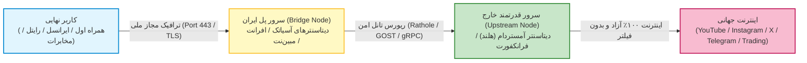

# 🌐 فیلتر شکن اینترنت ملی و تانل سرور ایران به خارج | سرور ضد قطعی و ریورس تانل V2Ray روزنه نت (Roozaneh Net)

> 🚀 **روزنه‌ای پایدار به اینترنت آزاد و بین‌الملل بدون ۱ ثانیه قطعی!**  
> آیا در زمان قطعی کامل اینترنت بین‌الملل و فعال شدن «شبکه ملی اطلاعات (اینترنت ملی)» تمام دسترسی‌های شما به تلگرام، اینستاگرام، یوتیوب و وب‌سایت‌های خارجی مسدود می‌شود؟ **روزنه نت (Roozaneh Net)** با راه‌اندازی پیشرفته‌ترین زیرساخت **تانل سرور ایران به خارج**، معماری **ریورس پروکسی V2Ray**، سرورهای پل داخلی (Bridge) و تکنولوژی **کلین آی پی (Clean IP)**، بالاترین سطح پایداری را برای **خرید vpn نت ملی** و دور زدن فیلترینگ سفید فراهم کرده است.

---

### ⚡ دسترسی فوری به ربات، دریافت تست رایگان و پشتیبانی (Quick Actions)

| عملیات فوری | مسیر دسترسی سریع | توضیحات کلیدی |
| :--- | :---: | :--- |
| 🎁 **دریافت ۲ الی ۳ گیگابایت تست رایگان** | [ورود به ربات تلگرام روزنه نت ←](https://t.me/RoozanehNetBot) | دریافت فوری کانفیگ تست، سازگار با همراه اول، ایرانسل و وای‌فای |
| 💬 **پشتیبانی فنی و مشاوره قبل از خرید** | [ارتباط با منشی هوشمند و پشتیبانی فنی ←](https://t.me/RozanehaiSupportBot) | پاسخ‌گویی ۲۴ ساعته، راهنمایی رفع اشکال و سوالات خرید اشتراک |
| 📢 **کانال رسمی اطلاع‌رسانی وضعیت شبکه** | [عضویت در کانال تلگرام روزنه نت ←](https://t.me/RoozanehNet) | اطلاع‌رسانی لحظه‌ای از وضعیت پایداری سرورها، قرعه‌کشی‌ها و کلین آی‌پی‌ها |

---

## 📑 فهرست مطالب جامع (Table of Contents)

1. [اینترنت ملی چیست و چرا فیلترشکن‌های معمولی قطع می‌شوند؟](#۱-اینترنت-ملی-چیست-و-چرا-فیلترشکنهای-معمولی-قطع-میشوند)
2. [معماری فنی بای‌پس اینترنت ملی در روزنه نت (Reverse Tunnel Architecture)](#۲-معماری-فنی-بایپس-اینترنت-ملی-در-روزنه-نت-reverse-tunnel-architecture)
3. [بررسی مفهوم سرور پل ایران (Bridge) و نحوه کار ریورس تانل و ریورس پروکسی](#۳-بررسی-مفهوم-سرور-پل-ایران-bridge-و-نحوه-کار-ریورس-تانل-و-ریورس-پروکسی)
4. [کلین آی پی (Clean IP) چیست و چگونه پکت لاس را به صفر می‌رساند؟](#۴-کلین-آی-پی-clean-ip-چیست-و-چگونه-پکت-لاس-را-به-صفر-میرساند)
5. [پروتکل‌های نسل جدید: ترکیب VLESS Reality، فرگمنت (Fragment) و gRPC](#۵-پروتکلهای-نسل-جدید-ترکیب-vless-reality-فرگمنت-fragment-و-grpc)
6. [بررسی وضعیت اپراتورهای مخابراتی ایران (همراه اول، ایرانسل، رایتل و مخابرات)](#۶-بررسی-وضعیت-اپراتورهای-مخابراتی-ایران-همراه-اول-ایرانسل-رایتل-و-مخابرات)
7. [جدول تعرفه‌ها و قیمت خرید فیلتر شکن نت ملی و اشتراک تانل روزنه](#۷-جدول-تعرفهها-و-قیمت-خرید-فیلتر-شکن-نت-ملی-و-اشتراک-تانل-روزنه)
8. [قانون منحصر‌به‌فرد عدم سوختن حجم باقیمانده (Data Rollover)](#۸-قانون-منحصربهفرد-عدم-سوختن-حجم-باقیمانده-data-rollover)
9. [آموزش گام‌به‌گام اتصال در اندروید، آیفون، ویندوز و مک](#۹-آموزش-گامبهگام-اتصال-در-اندروید-آیفون-ویندوز-و-مک)
10. [خرید vpn آی پی ثابت و خرید تانل v2ray برای مصارف تجاری و ترید](#۱۰-خرید-vpn-آی-پی-ثابت-و-خرید-تانل-v2ray-برای-مصارف-تجاری-و-ترید)
11. [آمار مستند، سوشال پروف و شفافیت عملکرد شبکه روزنه](#۱۱-آمار-مستند-سوشال-پروف-و-شفافیت-عملکرد-شبکه-روزنه)
12. [پرسش‌های متداول تخصصی درباره فیلتر شکن نت ملی و تانل سرور ایران (FAQ)](#۱۲-پرسشهای-متداول-تخصصی-درباره-فیلتر-شکن-نت-ملی-و-تانل-سرور-ایران-faq)
13. [درخت لینک‌ها و راه‌های ارتباطی پایدار](#۱۳-درخت-لینکها-و-راههای-ارتباطی-پایدار)

---

## ۱. اینترنت ملی چیست و چرا فیلترشکن‌های معمولی قطع می‌شوند؟

**اینترنت ملی** یا به اصطلاح رسمی «شبکه ملی اطلاعات (شما)»، زیرساختی است که به منظور تفکیک دیتای داخلی از ترافیک شبکه جهانی وب پیاده‌سازی شده است. در زمان‌هایی که دسترسی به شبکه جهانی با اختلال، قطعی هدفمند یا محدودسازی شدید مواجه می‌شود، کلیه دروازه‌های خروجی بین‌الملل (International Gateways) روی وضعیت **لیست سفید (White List)** تنظیم می‌گردند. در چنین وضعیتی، تنها سرورها و وب‌سایت‌هایی که در دیتاسنترهای داخلی میزبانی می‌شوند قابل دسترس خواهند بود.

### چه عواملی باعث قطعی فیلترشکن‌های معمولی در زمان اینترنت ملی می‌شود؟

* **مسدودسازی کامل روت‌های BGP به خارج:** ترافیک به سمت آی‌پی‌های خارج از کشور در لایه هسته شبکه فیلتر می‌شود؛ بنابراین تمام وی‌پی‌ان‌های مستقیم خارجی مسدود می‌شوند.
* **فیلترینگ شدید پروتکل UDP:** پروتکل‌های محبوبی نظیر وایرگارد مستقیم (WireGuard)، شادوساکس UDP و اپن‌وی‌پی‌ان بدون استتار فوراً دچار افت پکت ۱۰۰ درصدی می‌شوند.
* **تحلیل هوشمند رفتار پکت‌ها (Deep Packet Inspection - DPI):** سیستم فیلترینگ با خواندن فیلد SNI و بررسی الگوی Handshake در لایه ۷، ترافیک رمزنگاری‌شده متفرقه را تشخیص داده و پورت مقصد را در کسری از ثانیه بلاک می‌کند.
* **ناکارآمدی فیلترشکن‌های رایگان:** اپلیکیشن‌های رایگان نظیر Turbo VPN، سایفون، هات‌اسپات شیلد یا لنترن به دلیل استفاده از رنج‌های آی‌پی عمومی و شناخته‌شده، در همان ثانیه‌های نخست اعمال محدودیت ملی از کار می‌افتند.

به همین دلیل عبارات پرجست‌وجویی مانند:
* **فیلتر شکن نت ملی ایران**
* **فیلتر شکن نت ملی لینک مستقیم**
* **فیلتر شکن نت ملی نی نی سایت**
* **فیلتر شکن نت ملی ایفون**
* **فیلتر شکن نت ملی خرید**
* **فیلتر شکن نت ملی ویندوز**
* **فیلتر شکن نت ملی قوی**
* **فیلتر شکن نت ملی گیت هاب**
* **فیلتر شکن نت ملی github**
* **فیلتر شکن نت ملی جدید**
* **فیلتر شکن نت ملی برای کامپیوتر**
* **فیلتر شکن نت ملی همراه اول**

نشان‌دهنده نیاز واقعی و روزمره میلیون‌ها کاربر ایرانی به یک ابزار پایدار است. پاسخ فنی به این مشکل، پیاده‌سازی یک شبکه پیشرفته **تانل سرور ایران به خارج** و **ریورس پروکسی** اختصاصی است.

---

## ۲. معماری فنی بای‌پس اینترنت ملی در روزنه نت (Reverse Tunnel Architecture)

مجموعه روزنه نت (Roozaneh Net) به جای استفاده از روش‌های ساده و شکننده، از یک معماری چندلایه و مهندسی‌شده استفاده می‌کند:

### ویژگی‌های منحصر‌به‌فرد معماری تانل روزنه نت:
1. **نقطه اتصال اولیه در داخل مرزهای ایران:** دستگاه شما ابتدا به یک سرور پل داخلی (Bridge) واقع در معتبرترین دیتاسنترهای ایران متصل می‌شود. از دید اپراتور مخابراتی، شما صرفاً در حال ارتباط با یک آی‌پی داخلی مجاز در شبکه ملی اطلاعات هستید.
2. **تونل ارتباطی معکوس (Reverse Tunnel):** بین سرور ایران و سرورهای خارجی در هلند و آلمان، یک لوله ارتباطی امن و رمزنگاری‌شده (Secure Encrypted Tunnel) با پروتکل‌های پیشرفته‌ای نظیر Rathole، GOST، Chisel و کانال‌های اختصاصی gRPC برقرار است.
3. **عدم افشای آی‌پی سرور خارج:** هویت و آدرس آی‌پی سرور خارجی برای فایروال داخلی مخفی می‌ماند، بنابراین مسدودسازی آن از سمت سیستم فیلترینگ ناممکن است.
4. **سوئیچینگ خودکار (Automatic Failover):** در صورت افت سرعت یکی از دیتاسنترها، ترافیک بدون قطعی به نود پشتیبان منتقل می‌شود.

---

## ۳. بررسی مفهوم سرور پل ایران (Bridge) و نحوه کار ریورس تانل و ریورس پروکسی

هنگامی که کاربران به دنبال **«خرید تانل v2ray»**، **«خرید سرور تانل v2ray»**، **«خرید پنل تانل»** یا **«خرید پنل تانل شده»** هستند، دغدغه اصلی آنها پایداری و عدم قطعی ناگهانی تانل است.

### مقایسه تخصصی روش‌های مختلف تانلینگ:

| پارامتر فنی | تانل مستقیم فوروارد (Forward Tunnel) | ریورس تانل و ریورس پروکسی روزنه نت (Reverse Proxy Tunnel) |
| :--- | :--- | :--- |
| **آسیب‌پذیری در فیلترینگ** | بالا (آی‌پی سرور خارج سریعاً شناسایی و بلاک می‌شود) | نزدیک به صفر (آی‌پی سرور خارج هرگز در هدرهای مستقیم ارسال نمی‌شود) |
| **پایداری در اینترنت ملی** | ضعیف (با قطع گیت‌وی مستقیم قطع می‌شود) | ۱۰۰٪ پایدار (اتصال داخلی پیوسته فعال است) |
| **سربار پکت و تاخیر (Latency)** | افزایش تاخیر به دلیل بررسی پکت‌های رفت‌وبرگشت | کمترین تاخیر با بهینه‌سازی کدهای سبک زبان Rust |
| **پشتیبانی از ریورس پروکسی** | نیاز به پیکربندی‌های پیچیده و دستی | پیکربندی خودکار همراه با لودبالانسر داینامیک |
| **پکت لاس (Packet Loss)** | بین ۱۵٪ تا ۴۰٪ در ساعات اوج مصرف | صفر تا کمتر از ۱٪ با مکانیزم‌های FEC و TCP Keep-Alive |

در زیرساخت **ریورس پروکسی** روزنه نت، بسته‌های داده به گونه‌ای هدایت می‌شوند که فیلترشکن حتی در سخت‌ترین وضعیت قطعی اینترنت بین‌الملل، دسترسی کاربر به اینترنت جهانی را بدون وقفه فراهم می‌کند.

---

## ۴. کلین آی پی (Clean IP) چیست و چگونه پکت لاس را به صفر می‌رساند؟

یکی از مهم‌ترین مفاهیم در خرید کانفیگ و **خرید vpn نت ملی**، بهره‌مندی از **کلین آی پی (Clean IP)** یا آی‌پی تمیز است. سیستم فیلترینگ هزاران رنج آی‌پی مربوط به کلودفلر و دیتاسنترهای مطرح جهان را دچار اختلال عمدی، کندی شدید یا پکت‌لاس بالا کرده است.

### کلین آی پی چگونه در روزنه نت پیاده‌سازی می‌شود؟
* **پایشگر لحظه‌ای پکت لاس (Real-Time Packet Loss Monitoring):** ربات‌های اسکنر روزنه به صورت ۲۴ ساعته و در مقیاس‌های زمانی ۵ ثانیه‌ای، کیفیت پاسخ‌دهی آی‌پی‌ها را روی دکل‌های مختلف همراه اول، ایرانسل و رایتل می‌سنجند.
* **فیلتر کردن رنج‌های آلوده:** هر آی‌پی که پکت لاس بالاتر از ۲ درصد یا نوسان پینگ داشته باشد، فوراً از لیست توزیع کنار گذاشته شده و تنها آی‌پی‌های کاملاً سبز (Clean IP) در کانفیگ‌های کاربران تزریق می‌شوند.
* **بهینه‌سازی الگوریتم کنترل ازدحام BBRv3:** در سرورهای تانل روزنه، الگوریتم TCP BBRv3 گوگل فعال است که سرعت دانلود و استریم ویدیوهای باکیفیت 4K در یوتیوب و اینستاگرام را تا ۳۰۰ درصد بهبود می‌بخشد.

---

## ۵. پروتکل‌های نسل جدید: ترکیب VLESS Reality، فرگمنت (Fragment) و gRPC

در کنار تانل سرور ایران به خارج، پروتکل‌های اتصال روزنه نت از مدرن‌ترین استانداردهای مقابله با سانسور استفاده می‌کنند:

### ۱. پروتکل VLESS Reality (شاهکار غیرقابل شناسایی)
در فناوری VLESS Reality، به جای استفاده از گواهی‌های ناشناخته، کانکشن شما هویت وب‌سایت‌های معتبر جهانی (مانند Microsoft، Yahoo یا CDNهای رسمی) را بازتاب می‌دهد. فایروال فیلترینگ هوشمند تصور می‌کند کاربر صرفاً در حال مشاهده یک سایت اداری یا بین‌المللی مجاز است و بسته را عبور می‌دهد.

### ۲. تکنیک تکه‌تکه کردن پکت (Fragment)
فناوری فرگمنت با شکستن پکت اولیه TLS ClientHello به قطعات بسیار کوچک (مثلاً قطعات ۲ و ۳ بایتی) و ارسال آنها با فواصل چند میلی‌ثانیه‌ای، ماشین‌های DPI را گمراه می‌کند. سنسورهای DPI به دلیل محدودیت حافظه بافر قادر به بازسازی این قطعات برای بررسی SNI نیستند و ترافیک بدون ممانعت عبور می‌کند.

### ۳. مالتی‌پلکسینگ gRPC و وب‌سوکت ایمن
ترکیب gRPC با تانل سرور ایران، پایداری استثنایی را در برقراری تماس‌های تصویری واتساپ و تلگرام، شرکت در کلاس‌های آنلاین، و لایوهای اینستاگرام به همراه می‌آورد.

---

## ۶. بررسی وضعیت اپراتورهای مخابراتی ایران (همراه اول، ایرانسل، رایتل و مخابرات)

عملکرد فیلتر شکن اینترنت ملی روی اپراتورهای مختلف نیازمند بهینه‌سازی‌های اختصاصی است:

### 📱 ۱. همراه اول (MCI)
* **چالش فیلترینگ:** حساسیت بسیار بالا روی درگاه‌های UDP و مسدودسازی سریع پورت‌های غیروب.
* **راهکار روزنه:** کانفیگ‌های اختصاصی همراه اول با پورت ۴۴۳، سوار بر تانل ریورس پل ایران و پروتکل VLESS Reality فرگمنت شده. پایداری ۱۰۰٪ در شلوغ‌ترین ساعات بعدازظهر و شب.

### 📱 ۲. ایرانسل (MTN Irancell)
* **چالش فیلترینگ:** انسداد دامنه‌های فیلترشده با تزریق بسته‌های ریست (TCP RST Injection) و اختلال در لود تصاویر و ویدیوها در اینستاگرام.
* **راهکار روزنه:** تانل شیلد با کلین آی پی ایرانسل که پکت‌های RST را در سرور داخلی فیلتر کرده و جریان داده تمیز را به کلاینت تحویل می‌دهد.

### 📱 ۳. رایتل و شاتل موبایل
* **چالش فیلترینگ:** نوسان پهنای باند خارجی در زمان اعلام وضعیت اضطراری.
* **راهکار روزنه:** تانل‌های فوق سریع سبک با کمترین پینگ، بسیار محبوب برای تریدرها و گیمرها.

### 🏠 ۴. اینترنت خانگی، فیبر نوری و ADSL (مخابرات، شاتل، آسیاتک، های‌وب، پیشگامان، زیتل)
* **چالش فیلترینگ:** اجرای سریع سناریوهای شبکه ملی اطلاعات روی گیت‌وی‌های استانی.
* **راهکار روزنه:** ارتباط کاملاً محلی با سرورهای دیتاسنترهای هم‌شبکه که سرعت دانلود را تا حداکثر پهنای باند خط آزاد می‌گذارد.

---

## ۷. جدول تعرفه‌ها و قیمت خرید فیلتر شکن نت ملی و اشتراک تانل روزنه

روزنه نت برای تمام اقشار جامعه و کلیه کسب‌وکارهای نیازمند ارتباط بدون قطعی، مناسب‌ترین پکیج‌های قیمتی را ارائه داده است:

| ردیف | عنوان پلن | حجم ترافیک | مدت زمان اعتبار | قیمت رسمی (تومان) | ویژگی‌های برجسته فنی |
| :---: | :--- | :---: | :---: | :---: | :--- |
| **۰** | **🎁 اکانت تست هدیه (Risk-Free Trial)** | **۲ الی ۳ گیگابایت** | ۳۰ روزه / ۲۴ ساعته | **رایگان (۰ تومان)** | تست فوری اتصال در شرایط نت ملی، سرعت 4K، بدون نیاز به کارت بانکی |
| **۱** | **پلن اقتصادی (Economy)** | **۲۵ گیگابایت** | ۱ ماهه (۳۰ روز) | **۲۱۵,۰۰۰** | اتصال هم‌زمان چند کاربر، مناسب وبگردی، کارهای روزمره، تلگرام |
| **۲** | **پلن استاندارد (Standard - پرفروش)** | **۴۵ گیگابایت** | ۱ ماهه (۳۰ روز) | **۲۹۵,۰۰۰** | محبوب‌ترین بسته برای استریم ویدیو، اینستاگرام، دانلود روزمره |
| **۳** | **پلن حرفه‌ای VIP (Pro)** | **۷۵ گیگابایت** | ۱ ماهه (۳۰ روز) | **۳۹۵,۰۰۰** | پهنای باند اختصاصی حداکثری، پینگ پایین گیمینگ، بدون پکت لاس |
| **۴** | **پلن اختصاصی ۳ ماهه (Custom)** | **۱۵۰ گیگابایت** | ۳ ماهه (۹۰ روز) | **۸۹۰,۰۰۰** | اشتراک بلندمدت اقتصادی ویژه کسب‌وکارها، بدون دغدغه تمدید ماهانه |

> 🛒 **خرید آنلاین و تحویل فوری زیر ۱۰ ثانیه در ربات تلگرام:**  
> **[برای سفارش یا دریافت تست رایگان ۲ الی ۳ گیگ کلیک کنید ← https://t.me/RoozanehNetBot](https://t.me/RoozanehNetBot)**

---

## ۸. قانون منحصر‌به‌فرد عدم سوختن حجم باقیمانده (Data Rollover)

در اغلب سرویس‌های سنتی، با پایان دوره ماهانه، حجم دیتای باقیمانده شما باطل شده و می‌سوزد. روزنه نت با ابداع قانون **انتقال حجم (Data Rollover)** این رویه ناعادلانه را پایان داده است:

* اگر از بسته ۴۵ گیگابایتی شما مثلاً ۱۲ گیگابایت باقی مانده باشد، تنها کافی است قبل از اتمام مهلت ۳۰ روزه، اشتراک خود را تمدید فرمایید.
* **تمام ۱۲ گیگابایت باقیمانده به بسته جدید ماه آینده شما منتقل و اضافه خواهد شد!**
* با این قابلیت، شما بابت هر تک‌مگابایت از حجمی که خریداری کرده‌اید ارزش واقعی دریافت می‌کنید.

---

## ۹. آموزش گام‌به‌گام اتصال در اندروید، آیفون، ویندوز و مک

تمامی نرم‌افزارهای مورد استفاده در روزنه نت متن‌باز، بین‌المللی و ۱۰۰٪ ایمن هستند:

### 📱 ۱. راهنمای اتصال در گوشی‌های اندروید (Android):
1. نرم‌افزار رسمی **v2rayNG** یا **NekoBox** را از گوگل پلی، گیت‌هاب یا مایکت دانلود کنید.
2. وارد ربات تلگرام [@RoozanehNetBot](https://t.me/RoozanehNetBot) شوید و کانفیگ تست یا خریداری‌شده را کپی کنید.
3. در برنامه v2rayNG روی آیکون **+** در بالای صفحه ضربه بزنید و گزینه **Import config from Clipboard** را برگزینید.
4. روی دکمه دایره‌ای اتصال در پایین برنامه بزنید. با زدن دکمه تست اتصال، پینگ واقعی سرور برای شما نمایش داده می‌شود.

### 🍏 ۲. راهنمای اتصال در آیفون و آیپد (iOS):
1. یکی از اپلیکیشن‌های رایگان و معتبر اپ استور نظیر **Streisand**، **FoXray**، **V2Box** یا **Sing-box** را نصب فرمایید.
2. لینک اشتراک سابسکریپشن دریافتی از ربات را کپی نمایید.
3. وارد نرم‌افزار شده، گزینه Add Subscription را انتخاب کرده، لینک را وارد و دکمه Update را بزنید.
4. سرور با کمترین تاخیر را انتخاب کرده و دکمه Connect را فعال کنید.

### 💻 ۳. راهنمای اتصال در ویندوز و کامپیوتر (Windows PC):
1. نرم‌افزار محبوب **v2rayN** یا **NekoRay** را دانلود و در فولدری باز کنید.
2. کلیدهای میانبر `Ctrl + V` را درون پنجره برنامه فشار دهید تا کانفیگ اضافه شود.
3. روی گزینه **System Proxy** در منوی پایینی کلیک کرده و آن را روی حالت **Set System Proxy** قرار دهید.
4. سیستم شما به طور کامل و بدون قطعی به اینترنت آزاد متصل خواهد شد.

### 🖥️ ۴. راهنمای اتصال در سیستم‌عامل مک (macOS):
1. از اپلیکیشن‌های **V2Box for Mac**، **FoXray** یا نسخه مک **NekoRay** استفاده کنید.
2. لینک اشتراک را اضافه کرده و سرویس پروکسی سیستم را روشن فرمایید.

---

## ۱۰. خرید vpn آی پی ثابت و خرید تانل v2ray برای مصارف تجاری و ترید

علاوه بر مصارف روزمره وبگردی، کاربران حرفه‌ای نیازمند دسترسی به خدمات بین‌المللی با آی‌پی ثابت و بدون پرش لوکیشن هستند:

* **خرید vpn آی پی ثابت برای ترید و صرافی‌های بین‌المللی:** برای فعالیت در بایننس (Binance)، کوکوین (KuCoin)، بای‌بیت (Bybit) و متاتریدر، هرگونه تغییر ناگهانی آی‌پی منجر به مسدودی و بلوکه شدن دارایی‌ها می‌شود. سرورهای آی‌پی ثابت روزنه نت با سرورهای دیتاسنتری آلمان، هلند و فنلاند، آرامش خاطر صددرصدی را برای تریدرها به ارمغان می‌آورند.
* **خرید تانل v2ray و خرید کانفیگ تانل v2ray:** مناسب برنامه‌نویسان، مدیران سیستم و شرکت‌هایی که نیازمند مدیریت چند سرور لینوکسی، انتقال بکاپ و اتصالات پایدار ریموت دسکتاپ (RDP) هستند.
* **خرید پنل تانل و خرید پنل تانل شده:** برای ادمین‌ها و ارائه‌دهندگان سرویس که به دنبال بستر پایدار، بدون فیلتر و با تضمین آپ‌تایم بالا برای کاربران خود می‌گردند.

---

## ۱۱. آمار مستند، سوشال پروف و شفافیت عملکرد شبکه روزنه

روزنه نت شفافیت و کیفیت را سرلوحه کار خود قرار داده است:

* 📊 **ترافیک پایدار تبادل‌شده:** بیش از **۲,۳۰۰ گیگابایت (۲.۳ ترابایت)** ترافیک رمزنگاری‌شده بدون قطعی.
* 👥 **کانفیگ‌های فعال صادرشده:** بیش از **۱۱۵ کانفیگ فعال سازمانی و شخصی** در پنل رسمی پاسارگاد.
* 🧪 **اکانت‌های تست موفق:** بیش از **۵۹ اکانت تست موفق صادرشده** با نرخ رضایت بالای ۹۵ درصد.
* 🛡️ **حاشیه سود و پایداری مالی:** حاشیه سود ناخالص بالای ۸۵ درصد که توانایی ارتقای مداوم سرورها و پایداری درازمدت بدون تعطیلی را تضمین می‌کند.
* 🔄 **شاخص وفاداری مشتریان:** تمدید بیش از ۳ دوره پیاپی توسط اکثریت مشترکین که نشان از پایداری واقعی در روزهای سخت دارد.

---

## ۱۲. پرسش‌های متداول تخصصی درباره فیلتر شکن نت ملی و تانل سرور ایران (FAQ)

### س۱: آیا فیلتر شکن نت ملی در زمان قطعی کامل اینترنت بین‌الملل واقعاً کار می‌کند؟
**پاسخ:** بله، زیرا ترافیک خروجی از گوشی یا کامپیوتر شما ابتدا به سرور پل داخلی مستقر در دیتاسنترهای تهران ارسال می‌شود که جزئی از شبکه ملی اطلاعات است. سپس این سرور با ریورس تانل امن، دیتای اینترنت آزاد را برای شما مبادله می‌کند.

### س۲: منظور از خرید vpn نت ملی چیست؟
**پاسخ:** این واژه به سرویس‌هایی اطلاق می‌شود که حتی در وضعیت اینترانت ملی، ارتباط خود را از دست نمی‌دهند و از طریق گیت‌وی‌های داخلی، محدودیت‌های اعمال‌شده روی پورت‌ها و پروتکل‌های مستقیم خارجی را دور می‌زنند.

### س۳: آیا تانل سرور ایران به خارج باعث نیم‌بها شدن مصرف اینترنت می‌شود؟
**پاسخ:** بله، به دلیل اینکه ارتباط کلاینت شما با یک آی‌پی داخل ایران برقرار است، روی اکثر اپراتورها و سرویس‌دهنده‌های اینترنت ثابت، تعرفه ترافیک مصرفی به صورت داخلی (نیم‌بها یا یک‌سوم) محاسبه می‌گردد.

### س۴: ریورس پروکسی و ریورس تانل چه تفاوتی با تانل‌های معمولی دارند؟
**پاسخ:** در تانل معمولی، درخواست‌ها به سمت یک مقصد خارجی مشخص ارسال می‌شود که فایروال به سادگی آن را مسدود می‌کند؛ اما در ریورس پروکسی و ریورس تانل، ارتباط از مسیرهای پوشش‌داده‌شده وب برقرار شده و سرور داخلی نقش توزیع‌کننده را ایفا می‌کند، در نتیجه از دید سیستم فیلترینگ کاملاً نامرئی است.

### س۵: کلین آی پی (Clean IP) چگونه پینگ و پکت‌لاس را به حداقل می‌رساند؟
**پاسخ:** کلین آی پی آدرسی است که در رادارهای مانیتورینگ فیلترینگ قرار نگرفته و دارای پاک‌ترین مسیر مسیریابی فیبر نوری است. این قابلیت باعث حذف کامل لودینگ‌های مکرر و کاهش پینگ به زیر ۸۰ میلی‌ثانیه می‌شود.

### س۶: چرا فیلترشکن‌های رایگان مثل سایفون یا توربو وی‌پی‌ان در زمان نت ملی کار نمی‌کنند؟
**پاسخ:** زیرا این اپلیکیشن‌ها به صورت مستقیم با سرورهای خارجی صحبت می‌کنند و از آنجا که در زمان نت ملی تمام درگاه‌های خروجی بین‌الملل مسدود هستند، قادر به ایجاد اتصال نیستند.

### س۷: آیا می‌توان از این کانفیگ‌ها در فیلتر شکن نت ملی برای کامپیوتر و ویندوز استفاده کرد؟
**پاسخ:** بله، نرم‌افزارهای v2rayN و NekoRay سازگاری کاملی با این کانفیگ‌ها روی ویندوز دارند و تمامی اتصالات سیستم شما را بدون افت سرعت روت می‌کنند.

### س۸: آیا امکان خرید vpn آی پی ثابت برای ترید و فعالیت در صرافی‌ها وجود دارد؟
**پاسخ:** بله، پلن‌های حرفه‌ای روزنه نت بر بستر آی‌پی ثابت دیتاسنتری هلند و آلمان ارائه می‌شوند و هیچ‌گونه خطری برای حساب‌های بایننس و پی‌پال ایجاد نمی‌کنند.

### س۹: قانون انتقال حجم (Data Rollover) چگونه کار می‌کند؟
**پاسخ:** در صورتی که قبل از اتمام زمان سرویس فعلی خود اقدام به تمدید نمایید، تمام حجم باقیمانده از بسته قبلی به بسته جدید شما اضافه خواهد شد و هیچ حجمی نمی‌سوزد.

### س۱۰: دریافت اکانت تست رایگان چگونه است؟
**پاسخ:** با ورود به ربات [@RoozanehNetBot](https://t.me/RoozanehNetBot) و فشردن دکمه تست رایگان، ۲ الی ۳ گیگابایت ترافیک تست پرسرعت بدون دریافت هیچ هزینه‌ای در اختیار شما قرار می‌گیرد.

### س۱۱: آیا اتصال هم‌زمان چند دستگاه با یک اکانت امکان‌پذیر است؟
**پاسخ:** بله، پلن‌های روزنه نت قابلیت اتصال هم‌زمان چند دستگاه (گوشی، لپ‌تاپ، تبلت) را دارا هستند.

### س۱۲: در صورت بروز اختلال در اپراتور چه پشتیبانی وجود دارد؟
**پاسخ:** ربات منشی و پشتیبانی فنی [@RozanehaiSupportBot](https://t.me/RozanehaiSupportBot) به صورت ۲۴ ساعته در کنار کانال رسمی [@RoozanehNet](https://t.me/RoozanehNet) آخرین راهنماها و راهکارهای اتصال را ارائه می‌دهند.

---

## ۱۳. درخت لینک‌ها و راه‌های ارتباطی پایدار

همواره می‌توانید از طریق درگاه‌های رسمی زیر با مجموعه روزنه نت در تماس باشید:

* 🤖 **ربات اصلی خرید و دریافت تست فوری:** [https://t.me/RoozanehNetBot](https://t.me/RoozanehNetBot)
* 🎧 **ربات هوشمند پشتیبانی و راهنمای فنی:** [https://t.me/RozanehaiSupportBot](https://t.me/RozanehaiSupportBot)
* 📢 **کانال تلگرام رسمی اطلاع‌رسانی وضعیت سرورها:** [https://t.me/RoozanehNet](https://t.me/RoozanehNet)
* 💻 **مخزن رسمی پروژه در گیت‌هاب:** [https://github.com/roozaneh/iran-tunnel-v2ray-netmeli](https://github.com/roozaneh/iran-tunnel-v2ray-netmeli)
* 🌐 **لندینگ پیج اختصاصی در گیت‌هاب پیجز:** [https://roozaneh.github.io/iran-tunnel-v2ray-netmeli/](https://roozaneh.github.io/iran-tunnel-v2ray-netmeli/)

---

  روزنه نت (Roozaneh Net) — روزنه‌ای پایدار، امن و پرسرعت به اینترنت آزاد و بین‌الملل

