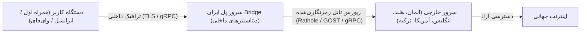

# 🌐 فیلترشکن اینترنت ملی و تانل سرور ایران به خارج | ریورس تانل <bdi>V2Ray</bdi> روزنه نت (<bdi>Roozaneh Net</bdi>)

> 🚀 **روزنه‌ای پایدار به اینترنت آزاد و بین‌الملل با معماری ریورس تانل**  
> در زمان اختلال اینترنت بین‌الملل و محدودسازی مسیرهای خروجی («شبکه ملی اطلاعات»)، **روزنه نت (<bdi>Roozaneh Net</bdi>)** با زیرساخت **تانل سرور ایران به خارج**، معماری **ریورس پروکسی <bdi>V2Ray</bdi>**، سرورهای پل داخلی (<bdi>Bridge</bdi>) و فناوری **کلین آی‌پی (<bdi>Clean IP</bdi>)**، اتصال پایداری را برای عبور از محدودیت‌های شبکه فراهم می‌کند.

---

> [!NOTE]
> 🌐 **شبکه وب‌سایت‌های لایو روزنه نت (<bdi>Live Web Network</bdi>):**  
> [🛍️ خرید <bdi>VPN</bdi> و تست رایگان](https://roozaneh.github.io/kharid-vpn-filter-shekan/) • [📡 کانفیگ همراه اول و ایرانسل](https://roozaneh.github.io/v2ray-configs-iran/) • [🛡️ تانل اینترنت ملی](https://roozaneh.github.io/iran-tunnel-v2ray-netmeli/) • [📲 دانلود نرم‌افزارها](https://roozaneh.github.io/v2ray-clients-download/)

### ⚡ دسترسی فوری به ربات، دریافت تست رایگان و پشتیبانی (<bdi>Quick Actions</bdi>)

| عملیات فوری | مسیر دسترسی سریع | توضیحات کلیدی |
| :--- | :---: | :--- |
| 🎁 **دریافت ۲ تا ۳ گیگابایت تست رایگان** | [ورود به ربات تلگرام روزنه نت ←](https://t.me/RoozanehNetBot?start=netmeli_tunnel) | تست ۳ روزه روی همراه اول، ایرانسل و وای‌فای خانگی |
| 💬 **پشتیبانی فنی و مشاوره قبل از خرید** | [ارتباط با پشتیبانی فنی ←](https://t.me/RoozanehHelp) | پاسخ‌گویی ۲۴ ساعته، راهنمایی رفع اشکال و سوالات خرید اشتراک |
| 📢 **کانال رسمی اطلاع‌رسانی وضعیت شبکه** | [عضویت در کانال تلگرام روزنه نت ←](https://t.me/RoozanehNet) | اطلاع‌رسانی وضعیت سرورها و راهنماهای اتصال |

---

> [!TIP]
> **🎁 تست رایگان پیش از خرید (<bdi>Risk-Free Trial</bdi>):**  
> برای اینکه عملکرد نودهای تانل ایران به خارج را روی شبکه خود بررسی کنید، **۲ تا ۳ گیگابایت تست رایگان ۳ روزه** دریافت نمایید:  
> 👉 **[ورود به ربات و دریافت فوری تست رایگان (<bdi>@RoozanehNetBot</bdi>)](https://t.me/RoozanehNetBot?start=netmeli_tunnel)**

> [!NOTE]
> **🔄 قانون انتقال حجم باقیمانده (<bdi>Data Rollover</bdi>) و تعهدات <bdi>SLA</bdi>:**  
> با تمدید دستی پیش از پایان دوره، ۱۰۰٪ حجم باقیمانده به اشتراک جدید منتقل می‌شود. همچنین قطعی‌های زیرساختی بالای ۳ ساعت به‌صورت خودکار با ۲ برابر زمان جبران شده و ضمانت عودت وجه ۲۴ ساعته برقرار است.

> [!IMPORTANT]
> **📘 شبکه مخازن رسمی و لینک‌های داخلی اکوسیستم روزنه نت:**  
> - 📥 **[دانلود مستقیم کلاینت‌های <bdi>V2Ray</bdi> (اندروید، آیفون، ویندوز، مک) ←](https://roozaneh.github.io/v2ray-clients-download/)**  
> - 🛒 **[راهنمای خرید <bdi>VPN</bdi> پرسرعت و بسته‌های فیلترشکن ←](https://roozaneh.github.io/kharid-vpn-filter-shekan/)**  
> - 📶 **[راهنمای تخصصی کانفیگ <bdi>V2Ray</bdi> همراه اول و ایرانسل + فرگمنت ←](https://roozaneh.github.io/v2ray-configs-iran/)**  
> - ❓ **[مطالعه راهنمای تانل معکوس، سرور پل و سوالات متداول اینترنت ملی ←](./FAQ_AND_TUNNEL_GUIDE.md)**  
> - 🌐 **[مشاهده پرتال مرکزی روزنه نت ←](https://roozaneh.github.io/)**

---

## 📱 جدول دانلود کلاینت‌های سازگار و لینک‌های رسمی

| سیستم‌عامل | کلاینت و نرم‌افزار سازگار | لینک دانلود مستقیم | راهنمای اتصال |
| :--- | :--- | :---: | :---: |
| **اندروید (<bdi>Android</bdi>)** | کلاینت رسمی **<bdi>v2rayNG</bdi>** و **<bdi>Happ</bdi>** | [📥 دانلود مستقیم <bdi>v2rayNG</bdi>](https://roozaneh.github.io/v2ray-clients-download/apps/v2rayng.html) | [مشاهده آموزش](#۷-آموزش-گامبهگام-اتصال-در-اندروید-آیفون-ویندوز-و-مک) |
| **آیفون (<bdi>iOS</bdi>)** | نرم‌افزار اپ‌استور **<bdi>Streisand</bdi>** و **<bdi>V2Box</bdi>** | [📲 دانلود <bdi>Streisand</bdi>](https://roozaneh.github.io/v2ray-clients-download/apps/streisand.html) | [مشاهده آموزش](#۷-آموزش-گامبهگام-اتصال-در-اندروید-آیفون-ویندوز-و-مک) |
| **ویندوز (<bdi>Windows</bdi>)** | نرم‌افزار رسمی **<bdi>v2rayN</bdi>** و **<bdi>NekoRay</bdi>** | [💻 دانلود <bdi>v2rayN</bdi>](https://roozaneh.github.io/v2ray-clients-download/apps/v2rayn.html) | [مشاهده آموزش](#۷-آموزش-گامبهگام-اتصال-در-اندروید-آیفون-ویندوز-و-مک) |
| **مک و لینوکس (<bdi>macOS / Linux</bdi>)** | کلاینت **<bdi>Hiddify</bdi>** و **<bdi>Sing-box</bdi>** | [🍏 دانلود <bdi>Hiddify</bdi>](https://roozaneh.github.io/v2ray-clients-download/apps/hiddify.html) | [مشاهده آموزش](#۷-آموزش-گامبهگام-اتصال-در-اندروید-آیفون-ویندوز-و-مک) |

---

## ۱. اینترنت ملی چیست و چرا فیلترشکن‌های معمولی از کار می‌افتند؟

**اینترنت ملی** یا «شبکه ملی اطلاعات»، زیرساختی برای تفکیک دیتای داخلی از ترافیک شبکه جهانی وب است. در زمان محدودسازی دروازه‌های خروجی بین‌الملل (<bdi>International Gateways</bdi>)، مسیرهای مستقیم به سرورهای خارج از کشور مسدود یا به‌شدت مختل می‌شوند:

1. **مسدودسازی روت‌های بین‌المللی (<bdi>BGP Null-Routing</bdi>):** اتصال مستقیم به آی‌پی‌های خارج از کشور تایم‌اوت می‌شود.
2. **محدودسازی پروتکل <bdi>UDP</bdi>:** پروتکل‌های سنتی مانند <bdi>OpenVPN</bdi> و <bdi>WireGuard</bdi> در لایه فایروال دراپ می‌شوند.
3. **بازرسی عمیق بسته‌ها (<bdi>DPI</bdi>):** سامانه‌های فیلترینگ با خواندن <bdi>SNI</bdi> و متادیتا، الگوهای پروکسی ساده را شناسایی می‌کنند.

---

## ۲. معماری فنی بای‌پس اینترنت ملی در روزنه نت (<bdi>Reverse Tunnel Architecture</bdi>)

* **دستگاه کاربر (<bdi>Client Side</bdi>):** اتصال از طریق کلاینت‌های استاندارد <bdi>V2Ray</bdi> نظیر <bdi>v2rayNG</bdi>، <bdi>Streisand</bdi>، <bdi>V2Box</bdi> یا <bdi>v2rayN</bdi>.
* **سرور پل ایران (<bdi>Iran Bridge Node</bdi>):** سرورهای واسط مستقر در دیتاسنترهای داخلی ایران.
* **تونل معکوس (<bdi>Reverse Core</bdi>):** انتقال رمزنگاری‌شده بسته‌ها با <bdi>Rathole</bdi>، <bdi>GOST</bdi> و <bdi>gRPC</bdi>.
* **سرورهای خارجی در ۵ لوکیشن فعال:** آلمان، هلند، انگلیس، آمریکا و ترکیه.

---

## ۳. مقایسه تانل مستقیم با ریورس تانل روزنه نت

| پارامتر مقایسه‌ای | تانل مستقیم (<bdi>Forward Tunnel</bdi>) | ریورس تانل روزنه نت (<bdi>Reverse Proxy Tunnel</bdi>) |
| :--- | :--- | :--- |
| **جهت برقراری سشن** | از داخل ایران به سمت خارج | از سرور خارج به سمت سرور پل داخل ایران (<bdi>Inbound</bdi>) |
| **رفتار در محدودیت خروجی** | مسدودسازی سریع مسیر مستقیم | هدایت ترافیک از طریق سرور پل داخلی |
| **پروتکل‌های استتار** | هدرهای ساده و قابل شناسایی | <bdi>VLESS Reality</bdi>، فرگمنت <bdi>TLS</bdi> و <bdi>gRPC</bdi> |
| **مدیریت حجم** | سوختن حجم در پایان ماه | انتقال ۱۰۰٪ حجم باقیمانده (<bdi>Data Rollover</bdi>) |

---

## ۴. بهینه‌سازی برای اپراتورهای ایران

| نام اپراتور | محدودیت رایج | راهکار پیشنهادی در تانل روزنه نت |
| :--- | :--- | :--- |
| **همراه اول (<bdi>MCI</bdi>)** | بستن پورت‌ها و محدودیت <bdi>TCP</bdi> | ریورس تانل سرور پل + <bdi>VLESS Reality</bdi> با فرگمنت |
| **ایرانسل (<bdi>MTN Irancell</bdi>)** | محدودسازی رنج‌های <bdi>Cloudflare</bdi> و تراتلینگ | کلین آی‌پی دیتاسنتری + تانل <bdi>gRPC</bdi> |
| **رایتل و اینترنت خانگی** | اختلال <bdi>SNI</bdi> و تأخیر <bdi>DNS</bdi> | سرور پل داخلی + رمزنگاری <bdi>TLS</bdi> |

---

## ۵. جدول تعرفه‌ها و خرید تانل <bdi>V2Ray</bdi>

تمام پلن‌ها شامل دسترسی به هر **۵ لوکیشن فعال** (آلمان، هلند، انگلیس، آمریکا، ترکیه)، استفاده **چندکاربره هم‌زمان (خانوادگی)** با مصرف منصفانه، **تمدید ۱۰۰٪ دستی**، **ضمانت عودت وجه ۲۴ ساعته** و **جبران خودکار ۲ برابری قطعی بالای ۳ ساعت (<bdi>SLA</bdi>)** هستند:

| نام بسته اشتراک | ترافیک تخصیصی | مدت اعتبار | تعرفه رسمی (تومان) | سفارش در ربات |
| :--- | :---: | :---: | :---: | :---: |
| **تست رایگان (<bdi>Free Trial</bdi>)** | **۲ تا ۳ گیگابایت** | ۳ روز | **رایگان (۰ تومان)** | [دریافت تست ←](https://t.me/RoozanehNetBot?start=netmeli_tunnel) |
| **اقتصادی (<bdi>Economy</bdi>)** | **۲۵ گیگابایت** | ۱ ماهه (۳۰ روز) | **۲۱۵,۰۰۰** | [سفارش ←](https://t.me/RoozanehNetBot?start=netmeli_tunnel) |
| **استاندارد (<bdi>Standard</bdi>)** | **۴۵ گیگابایت** | ۱ ماهه (۳۰ روز) | **۲۹۵,۰۰۰** | [سفارش ←](https://t.me/RoozanehNetBot?start=netmeli_tunnel) |
| **حرفه‌ای <bdi>VIP</bdi> (محبوب‌ترین)** | **۷۵ گیگابایت** | ۱ ماهه (۳۰ روز) | **۳۹۵,۰۰۰** | [سفارش ←](https://t.me/RoozanehNetBot?start=netmeli_tunnel) |
| **پلاس (<bdi>Plus</bdi>)** | **۱۰۰ گیگابایت** | ۱ ماهه (۳۰ روز) | **۴۹۵,۰۰۰** | [سفارش ←](https://t.me/RoozanehNetBot?start=netmeli_tunnel) |
| **پرمیوم (<bdi>Premium</bdi>)** | **۱۵۰ گیگابایت** | ۱ ماهه (۳۰ روز) | **۶۹۵,۰۰۰** | [سفارش ←](https://t.me/RoozanehNetBot?start=netmeli_tunnel) |
| **اختصاصی ۳ ماهه (<bdi>Quarterly</bdi>)** | **۱۵۰ گیگابایت** | ۳ ماهه (۹۰ روز) | **۸۹۰,۰۰۰** | [سفارش ←](https://t.me/RoozanehNetBot?start=netmeli_tunnel) |
| **مصرف آزاد بدون انقضا** | **از ۱۰ گیگ به بالا** | بدون انقضا | **هر گیگ ۸,۰۰۰** | [سفارش ←](https://t.me/RoozanehNetBot?start=netmeli_tunnel) |

---

## ۶. قانون انتقال حجم باقیمانده (<bdi>Data Rollover</bdi>)

چنانچه پیش از به پایان رسیدن مدت زمان اشتراک فعلی اقدام به تمدید دستی سرویس خود فرمایید، **۱۰۰٪ حجم مصرف‌نشده از دوره قبلی به بسته جدید اضافه می‌شود** و هیچ ترافیکی نمی‌سوزد.

---

## ۷. آموزش گام‌به‌گام اتصال در اندروید، آیفون، ویندوز و مک

### ۱. اتصال در اندروید با <bdi>v2rayNG</bdi>:
1. نرم‌افزار رسمی را نصب نمایید ([دانلود <bdi>v2rayNG</bdi>](https://roozaneh.github.io/v2ray-clients-download/apps/v2rayng.html)).
2. وارد **[ربات تلگرام <bdi>@RoozanehNetBot</bdi>](https://t.me/RoozanehNetBot?start=netmeli_tunnel)** شوید و لینک سابسکریپشن تست یا اشتراک خود را کپی کنید.
3. در برنامه علامت **+** را زده و گزینه **<bdi>Import config from Clipboard</bdi>** را انتخاب نمایید.
4. دکمه اتصال پایین صفحه را لمس کنید.

### ۲. اتصال در آیفون (<bdi>iOS</bdi>) با <bdi>Streisand</bdi> یا <bdi>V2Box</bdi>:
1. اپلیکیشن رایگان **<bdi>Streisand</bdi>** یا **<bdi>V2Box</bdi>** را از اپ‌استور دانلود فرمایید ([دانلود <bdi>Streisand</bdi>](https://roozaneh.github.io/v2ray-clients-download/apps/streisand.html)).
2. لینک سابسکریپشن دریافتی از ربات را کپی کرده و از بخش **+** با گزینه **<bdi>Add Subscription</bdi>** ثبت نمایید.
3. سرور دلخواه را انتخاب و اتصال را فعال کنید.

### ۳. اتصال در ویندوز با <bdi>v2rayN</bdi>:
1. برنامه **<bdi>v2rayN</bdi>** را نصب کنید ([دانلود <bdi>v2rayN</bdi>](https://roozaneh.github.io/v2ray-clients-download/apps/v2rayn.html)).
2. کلید ترکیبی **<bdi>Ctrl + V</bdi>** را فشار دهید تا سابسکریپشن بارگذاری شود و گزینه **<bdi>System Proxy -> Set System Proxy</bdi>** را فعال کنید.

---

## ۸. پرسش‌های متداول (<bdi>FAQ</bdi>)

<b>س۱: آیا فیلترشکن نت ملی در زمان محدودیت اینترنت بین‌الملل کار می‌کند؟</b>

بله، به دلیل استقرار سرورهای پل داخلی (<bdi>Bridge</bdi>) در دیتاسنترهای ایران و برقراری تونل معکوس رمزنگاری‌شده، در زمان محدودیت مسیرهای مستقیم بین‌الملل، ارتباط با ۵ لوکیشن خارجی برقرار می‌ماند.

<b>س۲: آیا قبل از خرید، تست رایگان ارائه می‌شود؟</b>

بله! ۲ تا ۳ گیگابایت ترافیک تست رایگان با اعتبار ۳ روزه از طریق [ربات تلگرام <bdi>@RoozanehNetBot</bdi>](https://t.me/RoozanehNetBot?start=netmeli_tunnel) تحویل داده می‌شود.

<b>س۳: قانون انتقال حجم (<bdi>Data Rollover</bdi>) و جبران قطعی (<bdi>SLA</bdi>) چگونه است؟</b>

با تمدید دستی پیش از انقضا، ۱۰۰٪ حجم باقیمانده منتقل می‌شود. همچنین قطعی‌های زیرساختی بالای ۳ ساعت به‌صورت خودکار با ۲ برابر زمان جبران می‌شوند و ضمانت عودت وجه ۲۴ ساعته برای مشکلات فنی برطرف‌نشده برقرار است.

<b>س۴: آیا اتصال هم‌زمان چند دستگاه امکان‌پذیر است؟</b>

بله، تمام پلن‌های روزنه نت قابلیت استفاده چندکاربره هم‌زمان (خانوادگی) را با رعایت مصرف منصفانه پشتیبانی می‌کنند.

---

## ۹. راه‌های ارتباطی رسمی

* 🤖 **ربات رسمی خرید و دریافت تست:** [<bdi>@RoozanehNetBot</bdi>](https://t.me/RoozanehNetBot?start=netmeli_tunnel)
* 🎧 **پشتیبانی فنی ۲۴ ساعته:** [<bdi>@RoozanehHelp</bdi>](https://t.me/RoozanehHelp)
* 📢 **کانال اطلاع‌رسانی:** [<bdi>@RoozanehNet</bdi>](https://t.me/RoozanehNet)
* 🌐 **وب‌سایت رسمی:** [<bdi>roozaneh.github.io/iran-tunnel-v2ray-netmeli</bdi>](https://roozaneh.github.io/iran-tunnel-v2ray-netmeli/)

